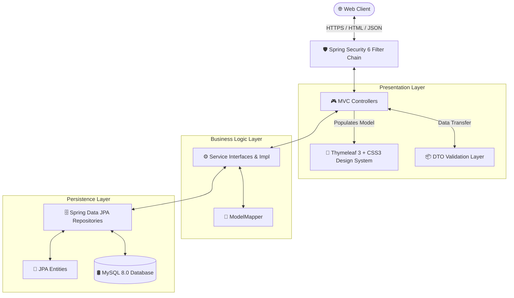

<div align="center">

# 🎓 Student Management System
### *Enterprise Student & Course Lifecycle Management Platform*

[](https://github.com/anushka-singh/student-management-system)
[](https://openjdk.org/)
[](https://spring.io/projects/spring-boot)
[](https://spring.io/projects/spring-security)
[](https://www.mysql.com/)
[](https://www.thymeleaf.org/)
[](LICENSE)

<br/>

**A full-stack, enterprise-grade academic administration suite built with Spring Boot 3, Spring Security 6, MySQL, and a modern, high-aesthetic UI design system.**

[Explore Features](#-feature-highlights) • [Design System](#-modern-design-system) • [Architecture](#-system-architecture) • [Quick Start](#-quick-start) • [Default Credentials](#-default-credentials) • [Author](#-author)

</div>

---

## 🌟 Overview

The **Student Management System** is an end-to-end web platform engineered to modernize academic workflows. Designed with a clean layered architecture, the platform streamlines student registration, course catalog administration, batch enrollment, real-time fee calculation, and role-secured management dashboards.

The application features a bespoke **Dark Sidebar & Indigo/Violet Gradient Design System** that departs from generic bootstrap templates to deliver a state-of-the-art, glassmorphism-enhanced SaaS user experience.

---

## 🎨 Modern Design System

The front-end is crafted with a dedicated custom design system (`style.css`), featuring tailored typography, harmonious color harmony, fluid responsive layouts, and rich micro-interactions.

### 🎭 Color Harmony & Tokens

| Token | Hex / Value | Usage | Preview |
|---|---|---|:---:|
| `--primary` | `#6366f1` | Indigo brand identity, primary CTA buttons |  |
| `--primary-dark` | `#4f46e5` | Button active states, gradient stops |  |
| `--accent` | `#8b5cf6` | Violet accent gradients, stat highlights |  |
| `--sidebar-bg` | `#0f172a` | Deep slate contrast sidebar |  |
| `--surface` | `#ffffff` | Clean elevated card surfaces |  |
| `--surface-2` | `#f8fafc` | Subtle background canvas |  |
| `--success` | `#10b981` | Active badges, confirmation alerts |  |
| `--warning` | `#f59e0b` | Course editing actions, warning pills |  |
| `--danger` | `#ef4444` | Form validation feedback, error banners |  |

### 💎 Visual Highlights

- **Glassmorphic Authentication**: Frosted acrylic backdrop blur (`backdrop-filter: blur(24px)`) on animated ambient gradient backgrounds.
- **Micro-Animations**: Hover elevations (`translateY(-2px)`), card entrance animations, and interactive checkbox reactions.
- **Dynamic Avatar Generation**: Auto-generated initials avatars with color-matched linear gradients.
- **Adaptive Mobile Layout**: Seamless sidebar collapse into a slide-over mobile drawer and responsive stacked card tables for touchscreens.
- **Status Pills**: Sleek, pill-shaped indicators for active/inactive status across courses and students.

---

## ⚡ Feature Highlights

```
┌─────────────────────────────────────────────────────────────────────────────┐
│                       STUDENT MANAGEMENT SYSTEM                             │
├──────────────────┬──────────────────┬──────────────────┬────────────────────┤
│  📊 Analytics    │  👨‍🎓 Students     │  📚 Courses      │  📝 Enrollments    │
│  Dashboard       │  Management      │  Catalog         │  & Billing         │
│                  │                  │                  │                    │
│  • Total Student │  • Full CRUD     │  • Code Badges   │  • Multi-Select    │
│  • Course Metrics│  • Unique Email  │  • Active Toggle │  • Live Calculator │
│  • Top Course    │  • Profile Views │  • Fee Structure │  • Student Summary │
│  • Recent Ledger │  • Pagination    │  • Descriptions  │  • Tuition Ledger  │
└──────────────────┴──────────────────┴──────────────────┴────────────────────┘
```

### 1. 📊 Executive Analytics Dashboard
- Live count of registered students and total course offerings.
- Dynamic identification of the **Top Performing Course** by enrollment density.
- Recent enrollments ledger with direct drill-down links to student enrollment profiles.

### 2. 👨‍🎓 Comprehensive Student Registry
- **Registration & Editing**: Input forms featuring required field indicators, placeholder guidelines, and real-time field error binding.
- **Data Integrity**: Server-side uniqueness checking on email addresses to prevent duplicate accounts.
- **Detailed Profiles**: Dedicated profile view displaying contact info, residential address, unique ID badge, and registration status.

### 3. 📚 Course Catalog & Curriculum Control
- Structured course codes (e.g., `CS101`, `WD301`) styled with dedicated code pills.
- Tuition fee configuration with currency formatting (`₹`).
- Status toggle allowing courses to be marked `Active` or `Inactive`.

### 4. 📝 Interactive Multi-Course Enrollment
- **Instant Tuition Estimator**: Checkbox multi-selection triggers instant client-side tuition calculation without page reloads.
- **Live Summary Sidebar**: Displays the selected student's name, email, chosen courses count, and grand total fee.
- **Enrollment Details**: Comprehensive breakdown of courses per student with totals in a professional receipt-style table.

### 5. 🔒 Enterprise Security & Protection
- Spring Security 6 filter chain with BCrypt password hashing.
- Universal **CSRF (Cross-Site Request Forgery)** token protection on all post submissions.
- Pre-seeded admin authentication with role-based dashboard access.

---

## 🏗️ System Architecture

The project follows a rigorous **Layered Architecture** adhering to SOLID principles:



---

## 🛠️ Technology Stack

| Layer | Component | Specification |
|---|---|---|
| **Core Platform** | Java | JDK 21 (LTS) |
| **Framework** | Spring Boot | v3.4.5 |
| **Security** | Spring Security | v6.x (BCrypt, CSRF, Session Management) |
| **Persistence** | Spring Data JPA / Hibernate | ORM, Auto Schema Validation (`update`) |
| **Database** | MySQL | v8.0+ via HikariCP connection pooling |
| **View Engine** | Thymeleaf | v3.1 + Spring Security Extras |
| **Frontend** | CSS3 Custom Tokens | Vanilla CSS, Bootstrap 5.3, Bootstrap Icons |
| **Type Mapping** | ModelMapper | v3.2.3 |
| **Validation** | Jakarta Validation | Hibernate Validator 8.x |
| **Build Tool** | Apache Maven | Maven 3.9+ with included `mvnw` wrapper |

---

## 🚀 Quick Start

### Prerequisites

Ensure you have the following installed on your local machine:
- **Java Development Kit (JDK 21 or higher)**
- **MySQL Server (8.0 or higher)**

---

### Step 1: Clone the Repository

```bash
git clone https://github.com/anushka-singh/student-management-system.git
cd student-management-system
```

---

### Step 2: Configure the Database

Open `studentmanagement/src/main/resources/application.properties` and verify your MySQL connection settings:

```properties
spring.application.name=studentmanagement

# MySQL Datasource Configuration
spring.datasource.url=jdbc:mysql://localhost:3306/student_mgmt_db?createDatabaseIfNotExist=true&serverTimezone=UTC
spring.datasource.username=root
spring.datasource.password=your_mysql_password

# JPA / Hibernate
spring.jpa.hibernate.ddl-auto=update
spring.jpa.show-sql=false
spring.jpa.properties.hibernate.format_sql=true
spring.thymeleaf.cache=false
```

> [!TIP]
> The database `student_mgmt_db` will automatically be created on startup if it doesn't already exist.

---

### Step 3: Run the Application

#### Windows (PowerShell / Command Prompt):
```powershell
cd studentmanagement
.\mvnw.cmd spring-boot:run
```

#### macOS / Linux:
```bash
cd studentmanagement
./mvnw spring-boot:run
```

---

## 🔑 Default Credentials

Upon startup, `DataInitializer` automatically populates the database with default administrative credentials and rich mock data (students, courses, and active enrollments):

<div align="center">

| Attribute | Access Detail |
|---|---|
| **Login URL** | [`http://localhost:8080/login`](http://localhost:8080/login) |
| **Username** | `Admin` |
| **Password** | `admin@123` |
| **Default Role** | `ADMIN` |

</div>

---

## 🗺️ Route Directory

| Endpoint | HTTP Method | View Template | Description |
|---|:---:|---|---|
| `/login` | `GET` | `login.html` | Custom glassmorphism login portal |
| `/dashboard` | `GET` | `dashboard.html` | Metrics overview & recent enrollments |
| `/students/list` | `GET` | `students.html` | Paginated student directory with search |
| `/students/new` | `GET` | `add-student.html` | Register a new student |
| `/students/save` | `POST` | — | Process new student creation |
| `/students/{id}` | `GET` | `view-student.html` | Detailed student profile view |
| `/students/{id}/edit` | `GET` | `edit-student.html` | Update student profile information |
| `/course/list` | `GET` | `courses.html` | Paginated catalog of academic courses |
| `/course/new` | `GET` | `add-course.html` | Register a new course offering |
| `/course/{id}` | `GET` | `view-course.html` | Course specification & fee display |
| `/course/{id}/edit` | `GET` | `edit-course.html` | Edit course curriculum & status |
| `/enrollments/showEnroll` | `GET` | `enroll-course.html` | Multi-select enrollment & live billing |
| `/enrollments/enrollCourse` | `POST` | — | Save new course enrollments |
| `/enrollments/enrollmentList` | `GET` | `enrolled-students.html` | Master enrolled students ledger |
| `/enrollments/getStudentEnrollmentDetails/{id}` | `GET` | `enrollment-details.html` | Student itemized tuition breakdown |

---

## 👩‍💻 Author

<div align="center">

### **Anushka Singh**

*Full Stack Software Engineer & Java Specialist*

[](https://github.com/anushka-singh)
[](https://linkedin.com)
[](https://github.com/anushka-singh)

</div>

---

## 📄 License

This project is licensed under the **MIT License** — see the [LICENSE](LICENSE) file for complete details.

```text
MIT License
Copyright (c) 2026 Anushka Singh. All rights reserved.
```
